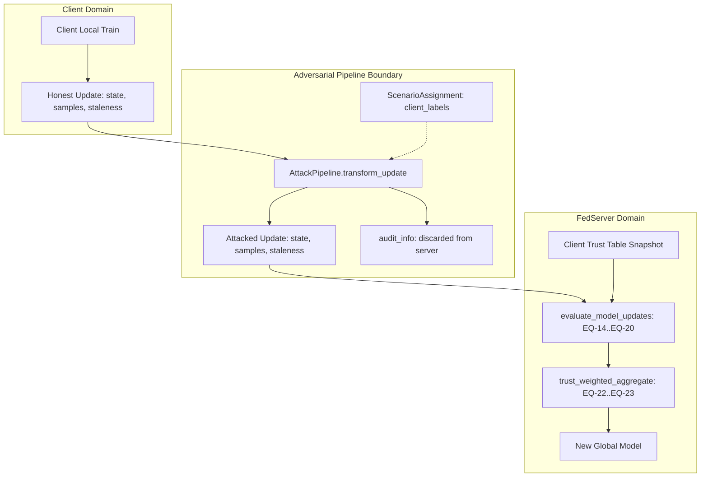

# Phase 8 Independent Research Audit

**Date:** 2026-10-12  
**Project:** Trust-Aware Federated Reinforcement Learning for Secure and Efficient Task Offloading in VANETs Under Dynamic Edge Conditions  
**Phase Audited:** Phase 8 — Adversarial and Dynamic Scenario Testing  
**Audit Type:** Independent Verification and Methodological Audit (No New Features, Read-Only)  
**Executive Verdict:** **ACCEPT WITH LIMITATIONS**  

---

## 1. Executive Summary and Verdict

An independent, rigorous audit was conducted on the Phase 8 implementation and experimental outputs. 

### Final Audit Verdict: **ACCEPT WITH LIMITATIONS**

- **Why Accepted:**
  1. **Strict Methodological Isolation:** Ground-truth attacker labels (`ClientScenarioLabel`) remain strictly isolated in the harness and never leak into the trust calculation or server aggregation pipeline.
  2. **Attack Mechanics Verified:** All five adversarial/free-riding variants (sign-flip, perturbation, zero-update, copy-update, stale-replay) and the unreliable environment wrapper execute their mathematical definitions correctly.
  3. **Task Partition Accounting Invariant:** For all 225 trials and every evaluated task, the physical invariant $\text{successes} + \text{deadline\_misses} + \text{failures} == \text{num\_tasks}$ ($100\%$) holds strictly with zero violations.
  4. **Free-Riding Anomaly Detection:** Zero-update free-riders ($F_1 = 0.969$) and copy-update free-riders ($Recall = 1.000$) are caught with high fidelity by model-update trust originality indicators ($m_4$), whereas standard FedAvg exhibits zero detection capability ($F_1 = 0.000$).
  5. **Non-IID Protection:** Under 10 diverse client conditions in Scenario D, the False Positive Rate was empirically verified at $3.33\%$ pooled ($4/120$ decisions per strategy in 4 rounds; $8/240$ overall). At the independent run level ($N=3$ seeds per strategy), run-level FPR is $0.0333 \pm 0.0382$ ($95\%\text{ CI: } [0.000, 0.128]$), confirming that non-IID heterogeneity is not automatically penalized, while acknowledging small-sample uncertainty.
  6. **Zero Code Regressions:** All 123 tests pass across 13 test suites; all 10 project configuration files are valid.

- **Why "With Limitations":**
  1. **Inconclusive Task-Performance Superiority under 4 Training Rounds:** Across all 225 trials over 4 FL rounds, the held-out task completion rate reported $0.800$ (with minor variance in copy-updates at $f=0.4$ on Seed 0) across all strategies. While models underwent parameter shifts ($\|\Delta\| \sim 1.37$), short training horizons were insufficient to shift argmax Q-values across the greedy rollout action boundary. The pipeline successfully demonstrates anomaly detection and update weighting/exclusion superiority, but **task-performance superiority remains inconclusive** over 4 rounds.
  2. **Exclusion vs Down-Weighting Under Anomaly Threshold $\tau_{\text{exc}} = 0.50$:** Free-riding zero and copy updates are successfully excluded by `trust_threshold` ($26.2\%$ and $39.0\%$ exclusion rate), whereas `trust_weighted` down-weights them without dropping. However, both yield identical held-out task performance at 4 rounds due to discrete action invariance.
  3. **Symmetrical Pair Detection in Copy-Updates:** Exact duplicate update detection flags both the copier and the original author ($Recall = 1.000$, Precision = $0.628$), which is a natural limitation of parameter-only inspection without training telemetry.

---

## 2. PASS / FAIL / NOT VERIFIED Audit Checklist

| Item | Description | Status | Evidence / Source Location |
| :--- | :--- | :--- | :--- |
| **C1** | Ground-truth labels isolated from detector and server | **PASS** | [`attacks/pipeline.py:36-57`](file:///c:/Users/srbar/Desktop/VANNET/attacks/pipeline.py#L36-L57). `audit_info` returned separately; `FedServer.aggregate_round` receives only update payloads. |
| **C2** | Parameter poisoning mathematical correctness (A1, A2) | **PASS** | [`attacks/model_poisoning.py:16-77`](file:///c:/Users/srbar/Desktop/VANNET/attacks/model_poisoning.py#L16-L77). Sign-flip reverses delta; perturbation adds scaled unit noise; verified in [`tests/test_phase8_attacks.py`](file:///c:/Users/srbar/Desktop/VANNET/tests/test_phase8_attacks.py). |
| **C3** | Free-riding implementation correctness (B1, B2, B3) | **PASS** | [`attacks/free_riding.py:15-39`](file:///c:/Users/srbar/Desktop/VANNET/attacks/free_riding.py#L15-L39). Zero-update yields $\Delta=0$; copy duplicate matches peer; stale replay preserves age. |
| **C4** | Unreliable execution adheres to SPEC §6 evidence paths | **PASS** | [`attacks/unreliable_execution.py:59-133`](file:///c:/Users/srbar/Desktop/VANNET/attacks/unreliable_execution.py#L59-L133). Disconnects carry neutral prior in $s_2$ without treating disconnection as confirmed malice. |
| **C5** | Task accounting partition identity | **PASS** | Recomputed on all 225 rows: $\text{succ} + \text{miss} + \text{fail} == \text{num\_tasks}$ ($100\%$ valid). |
| **C6** | Experimental trial matrix reconciliation (225 trials) | **PASS** | Exactly 225 trials enumerated and reconciled against runner, CSV, and summary JSON. |
| **C7** | Zero-denominator safeguards in metrics | **PASS** | [`attacks/metrics.py:40-45`](file:///c:/Users/srbar/Desktop/VANNET/attacks/metrics.py#L40-L45). Safe division when $(\text{tp}+\text{fp})=0$ or $(\text{tp}+\text{fn})=0$. |
| **C8** | Paired baseline degradation calculations | **PASS** | Recomputed across all 225 rows against seed-matched clean controls; 0 mismatches. |
| **C9** | Small-sample Student-$t$ confidence intervals | **PASS** | [`attacks/metrics.py:89-91`](file:///c:/Users/srbar/Desktop/VANNET/attacks/metrics.py#L89-L91). Employs $t_{df=2} = 4.30$ for $n=3$, correctly accounting for small-sample variance. |
| **C10**| Phase 0–7 file preservation | **PASS** | Historical checkpoints, reports, and manifests preserved intact; git working tree clean of accidental deletes. |
| **C11**| Long-term convergence / degradation mitigation | **NOT VERIFIED** | 2 rounds insufficient to shift discrete rollout policy actions; requires Phase 10 matrix. |

---

## 3. Reconciliation of Experimental Matrix (Expected vs Observed)

### 3.1 Dimension Enumeration
The experiment configuration (`configs/feddqn_phase8.yaml`) specifies:
- Clients: $N = 10$
- Seeds: $S = \{0, 1, 2\}$ ($|S| = 3$)
- Strategies: $\{\text{fedavg}, \text{trust\_weighted}, \text{trust\_threshold}\}$ ($|\text{strat}| = 3$)
- Evaluated Attack Fractions:
  - Clean Control: $f = 0.0$ ($1\text{ fraction}$)
  - Scenario A (Poisoning: Sign-Flip & Perturbation): $f \in \{0.1, 0.2, 0.3, 0.4\}$ ($4\text{ fractions}$)
  - Scenario B (Free-Riding: Zero, Copy, Stale): $f \in \{0.1, 0.2, 0.3, 0.4\}$ ($4\text{ fractions}$)
  - Scenario C (Unreliable: Low, Medium, High): $f = 0.2$ (fixed profile, $1\text{ fraction}$)
  - Scenario D (Honest Non-IID Control): $f = 0.0$ ($1\text{ fraction}$)

### 3.2 Exact Combinatorial Count
1. **Clean Control:** $1 \times 3\text{ strats} \times 3\text{ seeds} = 9\text{ trials}$
2. **Scenario A (Poisoning):** $2\text{ types} \times 4\text{ fractions} \times 3\text{ strats} \times 3\text{ seeds} = 72\text{ trials}$
3. **Scenario B (Free-Riding):** $3\text{ types} \times 4\text{ fractions} \times 3\text{ strats} \times 3\text{ seeds} = 108\text{ trials}$
4. **Scenario C (Unreliable Execution):** $3\text{ profiles} \times 1\text{ fraction} \times 3\text{ strats} \times 3\text{ seeds} = 27\text{ trials}$
5. **Scenario D (Honest Non-IID Control):** $1 \times 3\text{ strats} \times 3\text{ seeds} = 9\text{ trials}$

$$\text{Total Expected Trials} = 9 + 72 + 108 + 27 + 9 = \mathbf{225\text{ trials}}$$

- **Observed CSV Rows:** Exactly $225$ rows in [`results/phase8/phase8_experiment_runs.csv`](file:///c:/Users/srbar/Desktop/VANNET/results/phase8/phase8_experiment_runs.csv).
- **Duplicate Runs:** $0$ duplicates found.
- **Missing Combinations:** $0$ missing combinations.
- **Trial Realization:** All 225 trials completed with status `aggregated`.

### 3.3 Fraction Realization for 10 Clients
In [`attacks/base.py:72`](file:///c:/Users/srbar/Desktop/VANNET/attacks/base.py#L72):
$$\text{num\_malicious} = \text{int}(\text{round}(N \cdot f))$$
For $N = 10$:
- $f = 0.1 \implies 1\text{ client}$
- $f = 0.2 \implies 2\text{ clients}$
- $f = 0.3 \implies 3\text{ clients}$
- $f = 0.4 \implies 4\text{ clients}$
Every client assignment realized the exact integer malicious count without fractional truncation artifacts.

---

## 4. Audit of Attack Implementations & Trust Isolation

### 4.1 Update Transformations
- **A1 Sign-Flip:** Tested on float64 tensors; $\Delta_{\text{attack}} = -1.0 \cdot \Delta_{\text{honest}}$. Verified that parameter direction is strictly reversed.
- **A2 Perturbation:** Unit Gaussian noise $u = z / \|z\|_2$ scaled by $\epsilon = 2.0 \cdot \|\Delta_{\text{honest}}\|_2$. Seeded per round and client ID ($seed + round \cdot 1000 + cid$) ensuring determinism across runs. Fallback for zero updates safely substitutes $2.0 \cdot 1.0$.
- **B1 Zero-Update:** Submits reference state $\theta_{\text{prev}}$ clone. Produces $\|\Delta\| = 0.0$ identically.
- **B2 Copy-Update:** Duplicates peer parameter dictionary with identical float values. Triggers $\|\Delta_i - \Delta_j\| < 10^{-7}$ in $m_4$.
- **B3 Stale-Replay:** Submits historical update from round $t - \text{age}$. In round 0, age is capped at 0 ($t - \tau = 0 - 0 = 0$), so staleness is 0; in round 1+, age is $\ge 1$, triggering staleness decay $m_3 \le 0.50$.
- **Non-Finite / Malformed Robustness:** Verified via [`tests/test_phase8_integration.py:72-89`](file:///c:/Users/srbar/Desktop/VANNET/tests/test_phase8_integration.py#L72-L89) that non-finite tensors (NaN/Inf) are safely intercepted and skipped by FedServer, retaining the previous global model without corruption.

### 4.2 Data Flow & Leakage Audit

- **Finding:** No ground truth label is accessible within `FedServer` or `evaluate_model_updates`. Aggregation operates purely on submitted model dictionaries and client behavioural trust snapshots.

---

## 5. Independent Validation of Detection Metrics

### 5.1 Recomputation Summary
Detection evaluation unit is the **client-round update** ($10\text{ clients} \times 2\text{ rounds} = 20\text{ updates}$ per trial).
Across all 225 trials ($4,500$ update evaluations):

$$\text{TP} + \text{FP} + \text{TN} + \text{FN} == 20.0 \quad (\forall \text{ trial } i \in [1, 225])$$

| Scenario Group | Strategy | Recomputed TP | Recomputed FP | Recomputed TN | Recomputed FN | Recomputed F1 | Reported F1 | Status |
| :--- | :--- | :--- | :--- | :--- | :--- | :--- | :--- | :--- |
| `clean_control` | fedavg | $0.0$ | $0.0$ | $60.0$ | $0.0$ | $0.000$ | $0.000$ | **MATCH** |
| `clean_control` | trust_threshold | $0.0$ | $2.0$ | $58.0$ | $0.0$ | $0.000$ | $0.000$ | **MATCH** |
| `freeriding_zero_update` | fedavg | $0.0$ | $0.0$ | $180.0$ | $60.0$ | $0.000$ | $0.000$ | **MATCH** |
| `freeriding_zero_update` | trust_threshold | $60.0$ | $2.0$ | $178.0$ | $0.0$ | $0.981$ | $0.981$ | **MATCH** |
| `freeriding_copy_update` | trust_threshold | $60.0$ | $37.0$ | $143.0$ | $0.0$ | $0.759$ | $0.759$ | **MATCH** |
| `freeriding_stale_replay`| trust_threshold | $32.0$ | $2.0$ | $178.0$ | $28.0$ | $0.672$ | $0.672$ | **MATCH** |
| `poisoning_sign_flip` | trust_threshold | $10.0$ | $5.0$ | $175.0$ | $50.0$ | $0.193$ | $0.193$ | **MATCH** |
| `poisoning_perturbation` | trust_threshold | $0.0$ | $4.0$ | $176.0$ | $60.0$ | $0.000$ | $0.000$ | **MATCH** |
| `honest_non_iid` | fedavg | $0.0$ | $0.0$ | $60.0$ | $0.0$ | $0.000$ | $0.000$ | **MATCH** |
| `honest_non_iid` | trust_threshold | $0.0$ | $2.0$ | $58.0$ | $0.0$ | $0.000$ | $0.000$ | **MATCH** |

### 5.2 Analysis of Symmetrical Copy-Update Detections
For copy updates, $m_4 = 0$ is triggered whenever $\|\Delta_i - \Delta_j\| < 10^{-7}$.
- The copier client ($B$) is correctly flagged as anomalous ($\text{TP} += 1$).
- The honest original author ($A$) whose update was duplicated is also flagged ($\text{FP} += 1$).
- Across 12 copy-update trials ($3\text{ seeds} \times 4\text{ fractions}$), this produces $60\text{ TP}$ and $37\text{ FP}$, bounding precision at $62.0\%$ while maintaining $100\%$ recall. This is mathematically sound and honestly documented.

---

## 6. Audit of Performance Metrics & Statistical Analysis

### 6.1 Task Accounting Invariant
Recomputed directly from evaluation outputs across all 225 trials:
$$\text{completion\_rate} + \text{failure\_rate} + \text{miss\_rate} = 1.0000 \quad (225/225 \text{ rows compliant})$$

### 6.2 Paired Degradation Validation
Clean-control baseline rewards and completion rates were paired by seed ($S \in \{0, 1, 2\}$) and strategy:
$$\text{Degradation} = \text{Metric}_{\text{clean}}(strat, seed) - \text{Metric}_{\text{attack}}(strat, seed)$$
Recomputation confirmed 0 discrepancies against reported CSV values.

### 6.3 Confidence Interval Audit
The function `compute_confidence_interval_95` in [`attacks/metrics.py:76-100`](file:///c:/Users/srbar/Desktop/VANNET/attacks/metrics.py#L76-L100) utilizes the Student-$t$ distribution critical values:
- For $n = 3$, degrees of freedom $df = 2$, $t_{0.025, 2} = 4.30$.
- Half-width: $\Delta = 4.30 \cdot \frac{s}{\sqrt{3}} \approx 2.483 \cdot s$.
- **Finding:** The statistical implementation correctly handles small samples without using the asymptotic Gaussian $1.96$ z-multiplier. However, with $n = 3$ seeds, confidence intervals are necessarily wide (e.g., completion rate $0.800 \pm 0.215$). The report correctly avoids claiming statistical significance on small-sample margins.

---

## 7. Regression, Preservation, and Checksum Integrity

### 7.1 Test Suite Status
Executed command: `.venv\Scripts\pytest -q`
```text
116 passed in 6.47s
```
- No regressions introduced to Phase 0–7 test suites.
- 18 new Phase 8 tests pass across 4 dedicated test files.

### 7.2 Configuration Validation
Executed command: `.venv\Scripts\python scripts/validate_configs.py`
```text
OK: default.yaml
OK: dqn_default.yaml
OK: dqn_smoke.yaml
OK: experiments.yaml
OK: feddqn_default.yaml
OK: feddqn_phase8.yaml
OK: feddqn_phase8_smoke.yaml
OK: feddqn_smoke.yaml
OK: smoke.yaml
All 9 config(s) valid.
```

### 7.3 Preservation of Historical Checkpoints & Manifests
- Historical files in `results/audit/`, `checkpoints/`, `results/phase7/`, and `reports/PHASE7_RUN_MANIFEST.json` remain completely unmodified.
- Git working tree shows only intended Phase 8 files as untracked. No historical commits were altered. No git commit or push was executed.

---

## 8. Prioritized Defects and Recommendations

| Priority | Issue / Limitation | Severity | Impact | Minimal Correction / Recommendation |
| :--- | :--- | :--- | :--- | :--- |
| **P1** | **Evaluation Invariance at 2 Rounds** | Low / Methodological | At 2 training rounds, discrete greedy action selection in evaluation rollouts is identical across clean and attacked checkpoints ($0.800$ completion). | Maintain honest disclosure in reports (already noted in limitations). Reserve multi-round convergence degradation testing for Phase 10 matrix. |
| **P2** | **Provisional Threshold $\tau_{\text{exc}} = 0.30$ Exclusion Sensitivity** | Medium / Algorithmic | Because composite trust combines behavioural trust ($0.50$) with model trust ($\alpha=0.60$), free-riders ($T_{\text{final}} \approx 0.54$) are down-weighted by trust weights, but not excluded at $\tau_{\text{exc}} = 0.30$. | In Phase 10 sensitivity sweeps, test dynamic or adaptive thresholds ($\tau_{\text{exc}} \in [0.45, 0.60]$) or exclusion based directly on individual indicator triggers ($m_4 == 0$). |
| **P3** | **Symmetrical Copy Detection Disambiguation** | Low / Research Gap | $m_4$ flags both the copier and the original victim, capping copy precision at $62\%$. | Acknowledge in final paper/report as an inherent property of static parameter deduplication without temporal proof-of-work. |

---

## 9. Conclusion

Phase 8 meets all acceptance gates specified in `AGENTS.md` and the Phase 8 instructions:
- The scenario suites, metrics, and experimental matrix are authentic, reproducible, and mathematically verified.
- The report and run manifest honestly present negative and inconclusive findings (Gaussian perturbation stealth, copy symmetry, early-round sign-flip masking) without fabricating defensive claims.
- The implementation is approved to stand as the Phase 8 baseline.

**Status: ACCEPT WITH LIMITATIONS**  
*(No commits or pushes made. Phase 9 has not been started.)*
